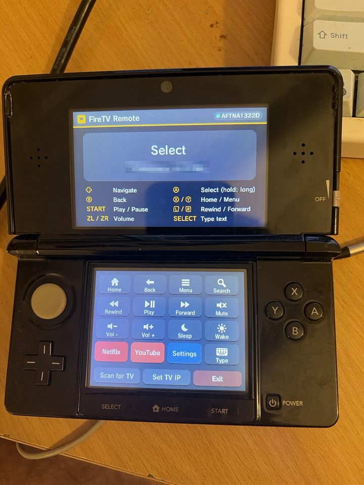

# FireTV Remote for 3DS

Turn a homebrew-enabled Nintendo 3DS into a Wi-Fi remote for an Amazon Fire TV.

**Why does this exist?** I put my Fire TV remote through the washing machine. 🧺 It did not survive. I did have a modded 3DS lying around, so I turned it into a new remote.

The 3DS speaks the **ADB protocol** directly to the Fire TV. No PC, Raspberry Pi or phone is needed once it's set up.

<p align="center"></p>

```
 ┌───────────┐   Wi-Fi / TCP 5555 (ADB)   ┌──────────┐
 │    3DS    │ ─────────────────────────▶ │ Fire TV  │
 │ (this app)│   input keyevent / text    │ (adbd)   │
 └───────────┘                            └──────────┘
```

✅ **Tested on real hardware:** an original (old) 3DS controlling a Fire TV over home Wi-Fi.

---

## Quick start (about 10 minutes)

### What you need

- A **3DS / 2DS with custom firmware** (Luma3DS + Homebrew Launcher + FBI). If you don't have that yet, follow [3ds.hacks.guide](https://3ds.hacks.guide).
- A **Fire TV** (Stick, Cube, or a Fire TV Edition TV) on the **same Wi-Fi** as the 3DS.
- One-time access to the TV's menus. If your remote is broken too, use the free **Amazon Fire TV** phone app, or plug a USB keyboard into the Fire TV (Enter = OK).

### 1. Turn on ADB debugging on the Fire TV

*Settings → My Fire TV → Developer Options → **ADB debugging → ON***

If you don't see **Developer Options**: open *Settings → My Fire TV → About* and click the device name **7 times**, then go back.

### 2. Download the app

Get the latest files from the [**Releases**](../../releases) page:

| File | Use it if you want… |
|---|---|
| `firetv-remote.cia` | an icon on the **HOME Menu** (recommended) |
| `firetv-remote.3dsx` | to launch it from the **Homebrew Launcher** |

### 3. Copy it to the 3DS

Pick whichever is easiest:

- **SD card reader:** put the `.cia` in `/cias/` (or the `.3dsx` in `/3ds/`) on the SD card.
- **Over Wi-Fi with ftpd:** open **ftpd** on the 3DS. The top screen shows an address such as `192.168.1.42:5000`. Connect to it from [FileZilla](https://filezilla-project.org/) (host = that IP, port = 5000, no username or password) and drag the file into `/cias/` (or `/3ds/`).

  From the command line instead (Windows, macOS and Linux all ship `curl`):
  ```sh
  curl -T firetv-remote.cia "ftp://192.168.1.42:5000/cias/firetv-remote.cia"
  ```

### 4. Install (only for the .cia)

On the 3DS, open **FBI**, then *SD → cias → firetv-remote.cia → **Install CIA***. **FireTV Remote** appears on the HOME Menu.

To update later, install the new `.cia` the same way. It replaces the old one, so there's no need to uninstall first.

### 5. First launch

1. **Key generation.** The app creates its own ADB key. This takes a few seconds on a New 3DS and **a few minutes on an original 3DS**. It only happens once.
2. **Finding the TV.** The app scans your network. If it can't find the TV, tap **Set TV IP** and type the address from *Settings → My Fire TV → About → Network*.
3. **Allow the connection.** The TV asks **"Allow USB debugging?"**. Tick **Always allow from this computer** and press **OK**.

When the top screen says **Connected** with a green dot, you're done. Later launches connect instantly.

---

## Controls

| 3DS | Fire TV |
|---|---|
| D-Pad / Circle Pad | Navigate (hold to repeat) |
| A | Select (hold = long press) |
| B | Back |
| X | Home |
| Y | Menu |
| START | Play / Pause |
| L / R | Rewind / Fast-forward |
| ZL / ZR (New 3DS) | Volume − / + |
| C-Stick ← / → (New 3DS) | Previous / Next |
| SELECT | Type text with the 3DS keyboard |
| Touch screen | Home, Back, Menu, Search, media keys, Mute, Vol ±, Sleep, Wake, **Netflix / YouTube / Settings**, Type, Scan for TV, Set TV IP, Exit |

> Volume and mute only work if your TV supports HDMI-CEC volume control, just like the original remote.

## Features

- Graphical UI on both screens with live connection status and button feedback
- Installs as a `.cia` with its own HOME Menu icon and banner, or runs as a `.3dsx`
- Types text on the TV with the 3DS keyboard (no more hunting on the on-screen keyboard)
- Finds the Fire TV automatically and remembers it
- Low latency: one persistent ADB shell, and repeated D-pad presses are batched

## Troubleshooting

| Problem | Fix |
|---|---|
| **"Can't reach x.x.x.x:5555 (err N)"** | Check that ADB debugging is on and both devices are on the same Wi-Fi. The TV's IP may have changed, so tap **Set TV IP**. Restarting the Fire TV can help too |
| Stuck on **"Accept 'Allow USB debugging?'"** | Accept the prompt on the TV using the phone app or a USB keyboard. If you dismissed it, press **A** to retry |
| **"TV rejected the key"** | The prompt was denied. Press **A** and choose **Allow** this time |
| Key generation seems frozen | Normal on an original 3DS. Give it a few minutes |
| Scan finds the wrong device | Another Android device has ADB open. Tap **Set TV IP** and enter the TV's address |
| Connection lost after the TV sleeps | Press **A** to reconnect |
| **FTP upload fails with `426`, or the file on the 3DS is 0 bytes** | The SD card is **full**. If the card has been used on a Mac, check for a hidden **`/.Trashes`** folder: macOS keeps "deleted" files there until the Trash is emptied. Delete its contents and try again |
| App doesn't appear on the HOME Menu | You copied the `.3dsx`, which only appears in the **Homebrew Launcher**. Use the `.cia` and install it with FBI |

## Security note

ADB gives **full shell access** to the Fire TV. The app stores its private key at `/3ds/firetv-remote/adbkey` on the SD card. Anyone with that file can control your TV, so treat it like a password and never share it or commit it anywhere. Only enable ADB debugging on networks you trust. To revoke access, use *Developer Options → Revoke USB debugging authorizations* (if your model has it) or turn ADB debugging off.

### Files the app keeps on the SD card

| Path | What |
|---|---|
| `/3ds/firetv-remote/adbkey` | The app's private ADB key (PEM). **Keep it private** |
| `/3ds/firetv-remote/tv-ip.txt` | The saved TV IP. Delete it to rescan |

*Shortcut:* if a PC is already authorized on your TV, copy its `~/.android/adbkey` to `/3ds/firetv-remote/adbkey` and the TV won't ask again.

---

## For developers

- **[docs/BUILDING.md](docs/BUILDING.md)**: build the `.3dsx` and `.cia` yourself on Windows, Linux or macOS
- **[docs/DEVLOG.md](docs/DEVLOG.md)**: how this project was built and tested, including the problems hit along the way and how they were fixed
- **Tests:** `tests/` contains a fake Fire TV (`mock_adbd.py`) that verifies RSA signatures and ADB flow control. The same `adb.c` the 3DS uses is compiled for your PC and run against it (see [BUILDING.md](docs/BUILDING.md#running-the-tests))

### How it works

`3ds/source/adb.c` is a small ADB host client built on POSIX sockets and mbedtls:

1. A `CNXN` handshake, after which the TV replies with an `AUTH` token
2. The client signs the token with its RSA key (PKCS#1 v1.5 / SHA-1). If the TV doesn't know the key, the client sends its public key in Android's `RSAPublicKey` format and the TV shows the "Allow" prompt
3. It opens one persistent `shell:` stream
4. Each button press becomes `input keyevent <code>` (or `input text`, `monkey -p <app>`), written with proper `WRTE`/`OKAY` flow control

`3ds/source/main.c` is the citro2d UI (both screens, with vector icons drawn in code), input handling and settings.

### Adding app shortcuts

Edit the `buttons[]` table in `main.c`. Find package names with `adb shell pm list packages`, then add an entry like:

```c
{ row, col, "LABEL", ACT_SHELL, 0, "monkey -p com.example.app -c android.intent.category.LAUNCHER 1" },
```

## Credits and license

MIT. See [LICENSE](LICENSE). Not affiliated with Amazon or Nintendo.

Built with [devkitPro](https://devkitpro.org/) (libctru, citro2d, citro3d, mbedtls). The CIA is packaged with [makerom](https://github.com/3DSGuy/Project_CTR) and [bannertool](https://github.com/diasurgical/bannertool), and its RSF is based on Steveice10's [buildtools](https://github.com/Steveice10/buildtools) template (MIT).
