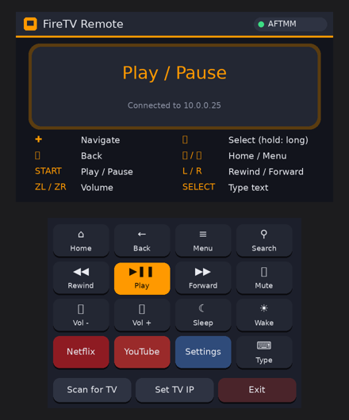

# FireTV Remote for 3DS

Turn a homebrew-enabled Nintendo 3DS into a Wi-Fi remote for an Amazon Fire TV.

The 3DS speaks the **ADB protocol** directly to the Fire TV. You don't need a PC, Raspberry Pi, or phone once it's set up. I built it because I broke my Fire TV remote and had a modded 3DS lying around.

```
 ┌──────────┐   Wi-Fi / TCP 5555 (ADB)   ┌──────────┐
 │   3DS    │ ─────────────────────────▶ │ Fire TV  │
 │ (this app)│   input keyevent / text   │ (adbd)   │
 └──────────┘                            └──────────┘
```



*(Mockup. On the device the button glyphs render with the 3DS system font.)*

## Features

- D-pad, select, back, home, menu, and media keys mapped to the 3DS buttons
- Clean graphical UI (citro2d): live connection status, animated feedback, and a touch panel with volume, mute, sleep/wake, search, and one-tap **Netflix / YouTube / Settings**
- Installs as a **.cia** with its own HOME Menu icon and banner, or runs as a `.3dsx` from the Homebrew Launcher
- **Type text** on the TV with the 3DS keyboard (no more on-screen keyboard hunting)
- Hold **A** for a long press (opens context menus)
- **Auto-finds the Fire TV** by scanning your network the first time
- Remembers the TV and its pairing key, so later launches connect instantly
- Fast: repeated D-pad presses are batched into one ADB call

## Controls

| 3DS | Fire TV |
|---|---|
| D-Pad / Circle Pad | Navigate (hold to repeat) |
| A | Select (hold = long press) |
| B | Back |
| X | Home |
| Y | Menu |
| START | Play / Pause |
| L / R | Rewind / Fast-forward |
| ZL / ZR (New 3DS) | Volume − / + |
| C-Stick ← / → (New 3DS) | Previous / Next |
| SELECT | Type text with the keyboard |
| Touch screen | Extra buttons, app shortcuts, scan / set TV IP, exit (vol / rewind / forward repeat when held) |

> Volume and mute only work if your TV supports HDMI-CEC volume control, the same as the original remote.

## Requirements

- A 3DS / 2DS with custom firmware and the Homebrew Launcher ([3ds.hacks.guide](https://3ds.hacks.guide))
- A Fire TV (stick, cube, or Fire TV Edition TV) on the **same Wi-Fi network**
- **ADB debugging** turned on: *Settings → My Fire TV → Developer Options → ADB debugging → ON*
  (if Developer Options is hidden: *My Fire TV → About*, click the device name 7 times)

## Install

Download from the [Releases](../../releases) page, or from the latest run on the **Actions** tab (artifacts `firetv-remote-cia` / `firetv-remote-3dsx`).

**Option A: HOME Menu app (.cia, recommended)**
1. Copy `firetv-remote.cia` to `/cias/` on the SD card.
2. Open **FBI**, then go to *SD → cias → firetv-remote.cia → Install CIA*.
3. **FireTV Remote** appears on the HOME Menu.

**Option B: Homebrew Launcher (.3dsx)**
1. Copy `firetv-remote.3dsx` to `/3ds/`.
2. Launch it from the Homebrew Launcher.

**Copying over Wi-Fi with ftpd:** open ftpd on the 3DS and note the address it shows (e.g. `192.168.1.42:5000`). Connect from FileZilla or any phone FTP app with that host and port and no login, then upload the file.

## First run

1. **Key generation:** the app creates its own ADB key (`/3ds/firetv-remote/adbkey`). This takes a few seconds on a New 3DS and **up to a few minutes on an original 3DS**. It only happens once.
   *Shortcut:* if a PC was already authorized on the TV, copy that PC's `~/.android/adbkey` to `/3ds/firetv-remote/adbkey` and the 3DS reuses it, so step 3 is skipped.
2. **Finding the TV:** the app scans your network for the Fire TV. If it can't find it, type the IP. You can find it under *Settings → My Fire TV → About → Network* or in your router's device list.
3. **Allow the connection:** the TV shows **"Allow USB debugging?"**. Tick *Always allow from this computer* and press OK.
   **Broken remote?** Use the free **Amazon Fire TV** phone app as a temporary remote, or plug a USB keyboard into the Fire TV (Enter = OK). You only need to do this once.

If the connection drops (e.g. the TV went to sleep), press **A** to reconnect. Tap **SET TV IP** to change TVs.

## Build from source

The GitHub Actions workflow builds the app on every push. To build locally:

```sh
# Install devkitPro: https://devkitpro.org/wiki/Getting_Started
sudo dkp-pacman -S 3ds-dev 3ds-mbedtls
make -C 3ds          # -> 3ds/firetv-remote.3dsx
make -C 3ds cia      # -> 3ds/firetv-remote.cia (needs makerom + bannertool on PATH)
```

`makerom` comes from [3DSGuy/Project_CTR](https://github.com/3DSGuy/Project_CTR) and `bannertool` from [diasurgical/bannertool](https://github.com/diasurgical/bannertool). The CI workflow builds both from source. The CIA's RSF is based on Steveice10's [buildtools](https://github.com/Steveice10/buildtools) template (MIT).

Pushing a tag like `v1.0.0` creates a GitHub Release with both files attached.

Send it straight to the 3DS with `3dslink 3ds/firetv-remote.3dsx` (press Y in the Homebrew Launcher first).

### Tests

`tests/` contains a fake Fire TV (`mock_adbd.py`). It does real RSA verification of the Android public-key format and enforces ADB flow control. The same `adb.c` the 3DS uses is compiled for your PC and tested against it:

```sh
pip install cryptography
sudo apt install libmbedtls-dev   # mbedtls 2.28
./tests/run.sh
```

## How it works

`3ds/source/adb.c` is a small, dependency-light ADB host client (POSIX sockets + mbedtls):

1. `CNXN` handshake → the TV replies with an `AUTH` token
2. Signs the token with the RSA key (PKCS#1 v1.5 / SHA-1). If the TV doesn't know the key yet, sends the public key in Android's `RSAPublicKey` format and the TV shows the "Allow" prompt
3. Opens one persistent `shell:` stream
4. Each button press becomes `input keyevent <code>` (or `input text`, `monkey -p <app>`), written to that stream with proper `WRTE`/`OKAY` flow control

`3ds/source/main.c` handles the citro2d UI (both screens, with vector icons drawn in code), input, and settings.

### Files on the SD card

| Path | What |
|---|---|
| `/3ds/firetv-remote.3dsx` | The app |
| `/3ds/firetv-remote/adbkey` | The app's private ADB key (PEM) |
| `/3ds/firetv-remote/tv-ip.txt` | The saved TV IP; delete it to rescan |

### Adding app shortcuts

Edit the `buttons[]` table in `main.c`. Find package names with the Fire TV app list or `adb shell pm list packages`, then use:

```c
{ row, col, "LABEL", ACT_SHELL, 0, "monkey -p com.example.app -c android.intent.category.LAUNCHER 1" },
```

## Security note

ADB gives full shell access to the Fire TV. Anyone holding `adbkey` can control it, so treat the file like a password. Only enable ADB debugging on networks you trust.

## Troubleshooting

| Problem | Fix |
|---|---|
| "Can't reach x.x.x.x:5555" | Check ADB debugging is on and both devices share a network. Fire TV IP may have changed: tap SET TV IP |
| Stuck on "Accept 'Allow USB debugging?'" | Accept the prompt on the TV (use the phone app or a USB keyboard). If you dismissed it, press A to retry |
| "TV rejected the key" | The prompt was denied. Reconnect and choose Allow |
| Key generation seems frozen | Normal on an original 3DS; give it a few minutes |
| Scan finds the wrong device | Another Android device has ADB open. Tap SET TV IP and enter the TV's address |

## License

MIT. See [LICENSE](LICENSE). Not affiliated with Amazon or Nintendo.
